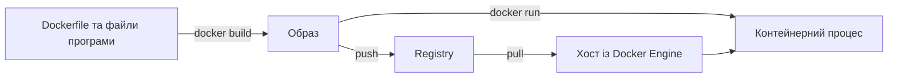
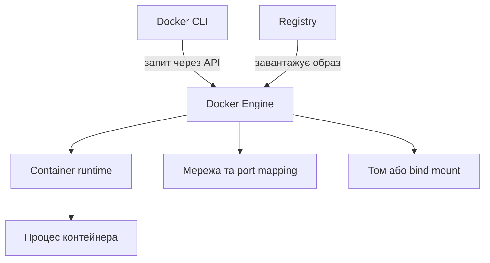
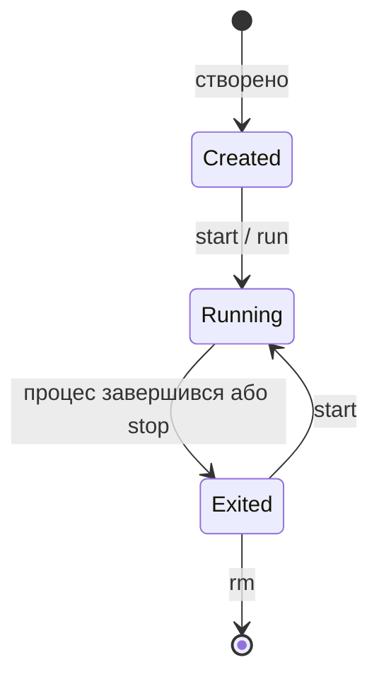
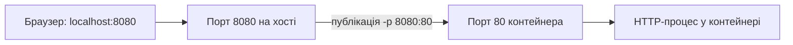
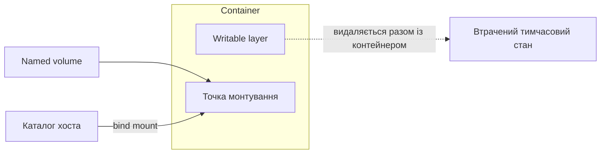

# Заняття 1. Управління контейнерами

**Формат:** групове, 2 аудиторні години. **Самостійна робота:** 4 години.

## Мета заняття

Після заняття курсант має вміти пояснити різницю між образом і контейнером, показати типовий життєвий цикл контейнера, прочитати базову команду запуску, пояснити port mapping та вибрати спосіб збереження даних.

## План на 2 години

| Час | Частина |
|---:|---|
| 0–10 хв | Мотивація: як однаково запускати програму на різних машинах |
| 10–30 хв | Образ, контейнер, registry та Docker Engine |
| 30–50 хв | Життєвий цикл, процеси й діагностика |
| 50–70 хв | Мережа контейнерів і публікація портів |
| 70–90 хв | Writable layer, bind mount і named volume |
| 90–110 хв | Демонстрація та запитання для групи |
| 110–120 хв | Підсумок і пояснення самостійної роботи |

## 1. Навіщо потрібна контейнеризація

Програма залежить від середовища: версії runtime, системних бібліотек, конфігурацій та файлів. Якщо кожен розробник встановлює залежності вручну, середовища поступово відрізняються. Контейнерний образ пакує програму та її залежності у відтворюваний артефакт.

Контейнер не є повною віртуальною машиною: він використовує ядро ОС хоста, а процеси ізольовані засобами ядра. Віртуальна машина, навпаки, має власне гостьове ядро. Контейнери зазвичай стартують швидше й використовують менше ресурсів, але межа ізоляції не тотожна окремому фізичному хосту.

### Образ і контейнер

- **Образ (image)** — шаблон файлової системи та параметрів запуску. Його шари зазвичай незмінні й можуть кешуватися.
- **Контейнер (container)** — процес, запущений з образу, зі своїм writable layer, мережею, змінними середовища та іншими параметрами.
- **Registry** — сервіс для зберігання та розповсюдження образів.
- **Runtime** — компонент, який створює й запускає контейнери. Docker Engine надає користувачу API/CLI та керує цим процесом.



Схема показує типовий шлях образу. Для локальної демонстрації push/pull до registry не обов'язковий: образ можна зібрати й запустити на одному хості.

### Із чого складається запуск



Коли запускається контейнер, Docker Engine готує файлову систему, мережеві налаштування, монтування і запускає головний процес. Якщо головний процес завершується, контейнер переходить у зупинений стан. Контейнер не є «маленьким сервером» сам по собі — це насамперед процес із заданим оточенням.

## 2. Життєвий цикл і базові команди

Типовий життєвий цикл:



Команди для огляду:

```bash
docker image ls
docker ps
docker ps -a
docker logs <container>
docker inspect <container>
```

`docker ps` показує запущені контейнери, а `docker ps -a` — також зупинені. `docker logs` показує стандартні потоки stdout/stderr процесу; це не обов'язково всі журнали програми. `inspect` виводить деталі конфігурації, тому перед передаванням його результату потрібно перевірити, чи немає там секретів.

У командах `<container>` — позначення, яке потрібно замінити реальним ім'ям або ID; кутові дужки не вводять. Наприклад, якщо ім'я контейнера `web`, команда має бути `docker logs web`.

## 3. Мережа і порти

У типовій конфігурації контейнер має власну мережеву адресу в Docker-мережі. Клієнт з хоста не завжди може напряму звернутися до цієї адреси, тому порт публікують:

```bash
docker run -d --name web-demo -p 8080:80 nginx:stable
```

Тут `8080` — порт хоста, `80` — порт усередині контейнера. Клієнт звертається до `http://localhost:8080`, а Docker спрямовує трафік до контейнера.



`EXPOSE 80` у Dockerfile — опис метаданих про порт, а не еквівалент `-p`; саме по собі це не створює зовнішній маршрут. Якщо процес у контейнері слухає інший порт або лише loopback-інтерфейс контейнера, port mapping не виправить налаштування процесу.

Мережі Docker дають змогу контейнерам однієї мережі звертатися одне до одного за DNS-іменем/alias. Публікувати порт назовні потрібно лише тоді, коли це потрібно для завдання.

## 4. Файлова система та збереження даних

Зміни, зроблені лише у writable layer контейнера, зникають після видалення контейнера. Це нормально для тимчасових файлів, але неприйнятно для даних, які потрібно зберегти.

| Спосіб | Де керується | Коли застосовувати |
|---|---|---|
| Writable layer контейнера | Контейнером | Тимчасовий стан, який не потрібно зберігати |
| Named volume | Docker | Дані сервісу, які мають пережити заміну контейнера |
| Bind mount | Хостом і шляхом у файловій системі хоста | Передавання конкретних файлів/каталогу, наприклад конфігурації |

Приклад named volume:

```bash
docker volume create web-content
docker run -d --name web-demo -p 8080:80 \
  -v web-content:/usr/share/nginx/html nginx:stable
```

Том залишається після видалення контейнера, але це не означає, що він має резервну копію. Видалення самого тому знищує дані. Bind mount надає контейнеру доступ до конкретного шляху хоста; надмірно широкі монтування збільшують наслідки помилки або компрометації контейнера.



## Демонстрація викладача

1. Показати `docker image ls`, запустити навчальний контейнер і порівняти `docker ps` з `docker ps -a`.
2. Зупинити контейнер, переглянути його статус, журнали й основні поля `inspect`.
3. Запустити HTTP-контейнер з port mapping та перевірити доступність з хоста.
4. Записати тестовий файл на named volume, видалити контейнер і запустити новий з тим самим томом.
5. Підкреслити, що дані зберігаються у томі, але для резервування потрібен окремий механізм.

## Запитання для обговорення

- Чому контейнер може завершитися відразу після запуску?
- Що збережеться після видалення контейнера, а що ні?
- Чому команда `-p 8080:80` не змінює порт програми?
- Коли зручніше використовувати bind mount, а коли named volume?
- Яка різниця між зупинкою контейнера та його видаленням?

## Самостійна робота: синтаксис YAML

Підготувати `notes.yaml` із трьома ключами, списком із двох елементів і вкладеною структурою. Наприклад:

```yaml
course: L1B
topic: containers
tools:
  - Docker
  - Kubernetes
note: "Ключ: значення записують так, щоб двокрапка не плуталася з роздільником"
```

Пояснити різницю між мапою (ключі та значення) і списком. Відступи мають бути послідовними; табуляція замість пробілів у YAML часто призводить до помилки.

## Контроль засвоєння

Курсант усно пояснює різницю між образом і контейнером, розшифровує port mapping і наводить приклад даних, які слід винести в volume.
