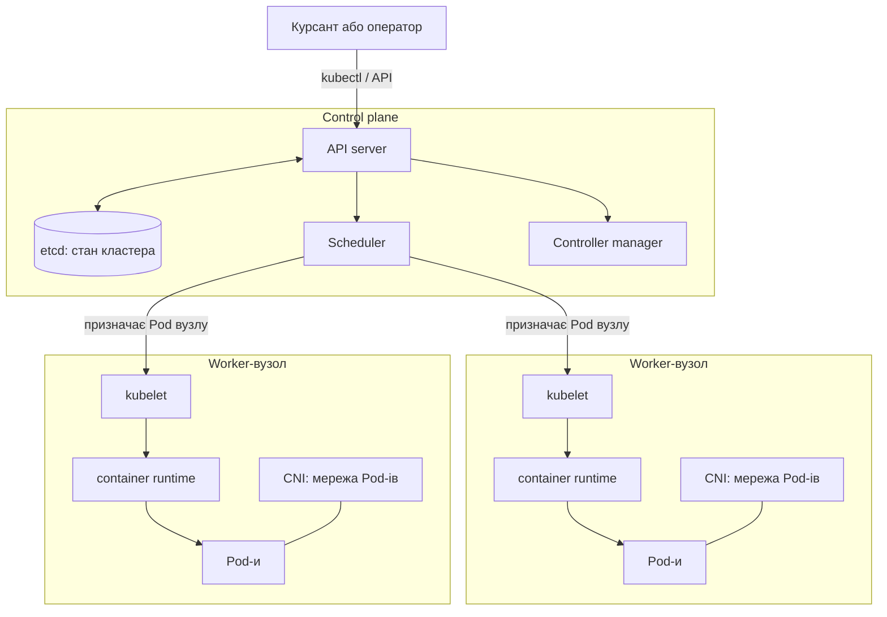
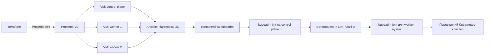
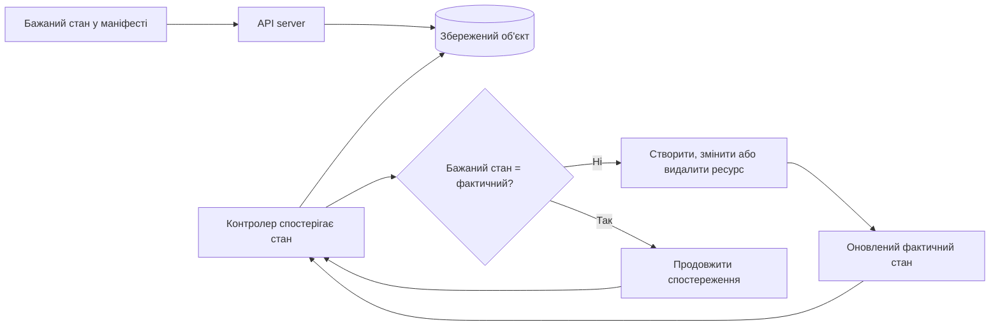

# Заняття 3. Знайомство з Kubernetes

**Формат:** групове, 2 аудиторні години. **Самостійна робота:** 3 години.

## Мета заняття

Зрозуміти, які проблеми вирішує оркестрація контейнерів, описати основні компоненти Kubernetes-кластера і пояснити, як декларативний маніфест перетворюється на запущений Pod.

## План на 2 години

| Час | Частина |
|---:|---|
| 0–10 хв | Повторення Docker і постановка задачі |
| 10–30 хв | Kubernetes: кластер, control plane та worker-вузли |
| 30–45 хв | Terraform: VM у Proxmox |
| 45–65 хв | Ansible: підготовка вузлів і kubeadm |
| 65–85 хв | API objects, Pod та бажаний стан |
| 85–105 хв | Демонстрація `kubectl` і перевірка кластера |
| 105–115 хв | Порівняння Docker Compose та Kubernetes, запитання |
| 115–120 хв | Підсумок і самостійна робота |

## 1. Навіщо потрібна оркестрація

Docker зручний для запуску контейнера на одному хості. Коли застосунок має багато екземплярів, кілька машин, оновлення без простою, перевірки стану й автоматичне відновлення, ручне керування стає складним.

Kubernetes допомагає:

- розміщувати workload-и на вузлах з урахуванням доступних ресурсів;
- підтримувати задану кількість екземплярів;
- надавати стабільний мережевий доступ через Service;
- виконувати керовані оновлення;
- описувати інфраструктурні об'єкти декларативно.

Kubernetes не виправляє помилки в коді, не створює резервні копії бази автоматично, не є registry образів і не гарантує безпечність застосунку. Для цих задач потрібні окремі інструменти та процеси.

## 2. Архітектура кластера

Кластер складається з control plane, який приймає й узгоджує запити, та worker-вузлів, де запускаються Pod-и.



- **API server** — основна точка взаємодії з Kubernetes API. `kubectl` надсилає запити саме через нього.
- **etcd** — сховище стану та конфігурації кластера. Воно не є сховищем даних користувацьких застосунків.
- **Scheduler** — вибирає вузол для Pod-а, який ще не призначено.
- **Controller manager** — запускає контролери, що спостерігають за ресурсами та коригують стан.
- **kubelet** на вузлі забезпечує виконання Pod-ів, описаних у кластері.
- **Container runtime** запускає контейнери на вузлі.
- **CNI-плагін** забезпечує мережу Pod-ів. Без правильно налаштованого CNI вузол або Pod-и можуть бути не готові.

У навчальній схемі control plane та worker-и можуть бути окремими VM у Proxmox. Proxmox — платформа віртуалізації, а не частина Kubernetes API.

## 3. Навчальний кластер на Proxmox: Terraform + Ansible

У цій демонстрації Terraform створює віртуальні машини, а Ansible налаштовує операційну систему та встановлює Kubernetes. Це два окремі етапи: Terraform не встановлює Kubernetes, а Ansible не створює VM у Proxmox.



Для двогодинної демонстрації образ ОС, доступ до пакетних репозиторіїв і мережу потрібно підготувати заздалегідь. Повне створення VM і завантаження пакетів може тривати довше за відведений час. На занятті викладач показує план, запускає заздалегідь перевірений сценарій і пояснює, як перевірити результат.

### Передумови та топологія

Приклад навчальної топології:

| Вузол | Роль | Приклад мінімальних ресурсів для лабораторії |
|---|---|---|
| `l1b-cp1` | Kubernetes control plane | 2 vCPU, 4 GiB RAM |
| `l1b-worker1` | Worker | 2 vCPU, 2–4 GiB RAM |
| `l1b-worker2` | Worker | 2 vCPU, 2–4 GiB RAM |

Це стартові орієнтири, не універсальна production-конфігурація. Перевірити доступну пам'ять і CPU на Proxmox; лишити ресурсний запас для хоста. Для всіх вузлів заздалегідь визначити унікальні VM ID, імена, IP-адреси, шлюз, DNS, storage та Linux bridge/VLAN.

Перед початком викладач перевіряє:

1. Версію Proxmox VE (`pveversion -v`) і сумісність із вибраною версією провайдера.
2. Наявність cloud-init шаблону Linux із QEMU guest agent, SSH-доступом та придатним диском.
3. Мережеву зв'язність VM між собою й доступ до потрібних репозиторіїв та registry.
4. Відсутність перетину між адресами вузлів, Pod CIDR і локальними мережами.
5. Що API Proxmox доступний лише викладачеві/адміністраторам, а API Kubernetes не виставлений у публічний інтернет.

Для прикладів нижче використано провайдер `bpg/proxmox`. Його вимоги до Proxmox VE змінюються між версіями: перевірити актуальну документацію провайдера перед практичним запуском. Якщо TLS-сертифікат Proxmox внутрішній, краще довірити його CA на робочій машині; не обходити перевірку сертифіката в постійній конфігурації.

### Terraform: опис VM

Фрагмент `main.tf` показує структуру конфігурації для клонування підготовленого cloud-init шаблону. Номер шаблону, вузол Proxmox, storage, bridge, адреси й публічний SSH-ключ мають відповідати конкретній лабораторії.

```hcl
terraform {
  required_providers {
    proxmox = {
      source  = "bpg/proxmox"
      version = "~> 0.123.1"
    }
  }
}

provider "proxmox" {
  endpoint = var.proxmox_endpoint
  # API token передається через PROXMOX_VE_API_TOKEN,
  # а не записується в цей файл.
}

variable "proxmox_endpoint" {
  type = string
}

variable "pve_node" {
  type = string
}

variable "template_vm_id" {
  type = number
}

variable "bridge" {
  type = string
}

variable "gateway" {
  type = string
}

variable "cidr_prefix" {
  type = number
}

variable "vm_username" {
  type = string
}

variable "ssh_public_key" {
  type = string
}

variable "nodes" {
  type = map(object({
    vm_id     = number
    ip        = string
    cores     = number
    memory_mb = number
  }))
}

resource "proxmox_virtual_environment_vm" "k8s_node" {
  for_each  = var.nodes
  name      = each.key
  vm_id     = each.value.vm_id
  node_name = var.pve_node
  tags      = ["l1b", "terraform"]

  clone {
    vm_id = var.template_vm_id
    full  = true
  }

  cpu {
    cores = each.value.cores
  }

  memory {
    dedicated = each.value.memory_mb
  }

  agent {
    enabled = true
  }

  initialization {
    ip_config {
      ipv4 {
        address = "${each.value.ip}/${var.cidr_prefix}"
        gateway = var.gateway
      }
    }

    user_account {
      username = var.vm_username
      keys     = [var.ssh_public_key]
    }
  }

  network_device {
    bridge = var.bridge
  }
}
```

Це навчальний шаблон, а не готовий файл для будь-якого Proxmox: cloud-init шаблон має підтримувати задані параметри, а значення `node_name`, `bridge`, VM ID, storage та адресацію потрібно звірити з вашим середовищем. Якщо в шаблоні не встановлено QEMU guest agent, його треба встановити в образі або вимкнути блок `agent` і не покладатися на автоматичне отримання IP від провайдера.

Для локальних значень створіть `terraform.tfvars`, який не комітиться. У ньому викладач задає `proxmox_endpoint` зі значенням URL свого Proxmox API; у матеріалах для Git використовуйте лише шаблонне значення, якщо репозиторій доступний публічно. Токен, паролі та приватний ключ не фіксуйте в Git. Сам API token передавайте через змінну середовища `PROXMOX_VE_API_TOKEN` або контрольоване сховище секретів. Не вмикайте `insecure = true` для постійної роботи.

Додайте локальні файли Terraform до `.gitignore`:

```gitignore
.terraform/
*.tfstate*
*.tfplan
tfplan
terraform.tfvars
terraform.tfvars.json
```

Приклад структури значень `nodes` (адреси `192.0.2.0/24` зарезервовані для документації — замінити на адресу виділеної лабораторної VLAN):

```hcl
nodes = {
  l1b-cp1 = {
    vm_id = 9101
    ip = "192.0.2.10"
    cores = 2
    memory_mb = 4096
  }
  l1b-worker1 = {
    vm_id = 9102
    ip = "192.0.2.11"
    cores = 2
    memory_mb = 3072
  }
  l1b-worker2 = {
    vm_id = 9103
    ip = "192.0.2.12"
    cores = 2
    memory_mb = 3072
  }
}
```

Безпечний порядок роботи з Terraform:

```bash
terraform fmt -check
terraform init
terraform validate
terraform plan -out=tfplan
terraform show tfplan
terraform apply tfplan
```

Перед `apply` викладач перевіряє план: чи створюються саме навчальні VM, чи не змінюються чужі ресурси й чи коректні імена/IP. Файли `terraform.tfstate*`, `tfplan` і `terraform.tfvars` не додають у Git. Terraform state може містити чутливу інформацію та метадані інфраструктури.

### Ansible: підготовка вузлів і встановлення Kubernetes

Після створення VM Ansible підключається до них через SSH. Інвентар задає групи, за якими playbook застосовує спільну підготовку, ініціалізацію control plane та приєднання worker-ів.

```yaml
# inventory/hosts.yml — адреси замінити на видані лабораторією
all:
  children:
    k8s_cluster:
      children:
        k8s_control_plane:
          hosts:
            l1b-cp1:
              ansible_host: 192.0.2.10
        k8s_workers:
          hosts:
            l1b-worker1:
              ansible_host: 192.0.2.11
            l1b-worker2:
              ansible_host: 192.0.2.12
      vars:
        ansible_user: ubuntu
        ansible_ssh_private_key_file: "~/.ssh/l1b_ed25519"
        ansible_become: true
```

Приватний SSH-ключ залишається на машині викладача або в сховищі секретів. Не копіювати його до inventory чи Git.

Приклад структури playbook:

```yaml
---
- name: Підготувати всі вузли
  hosts: k8s_cluster
  become: true
  roles:
    - common
    - containerd
    - kubeadm

- name: Ініціалізувати control plane та мережу Pod-ів
  hosts: k8s_control_plane
  become: true
  roles:
    - control_plane

- name: Приєднати worker-вузли до кластера
  hosts: k8s_workers
  become: true
  roles:
    - worker
```

Назви `common`, `containerd`, `kubeadm`, `control_plane`, `worker` — ролі, які потрібно реалізувати в `roles/`; це каркас послідовності, а не самодостатній playbook для запуску без цих ролей.

У ролях Ansible викладач демонструє такі етапи:

1. **`common`** — перевірити hostname, мережу, час і передумови Linux; налаштувати swap відповідно до актуальної інструкції Kubernetes.
2. **`containerd`** — встановити й запустити runtime; переконатися, що його конфігурація сумісна з kubelet (зокрема cgroup driver).
3. **`kubeadm`** — додати офіційне джерело пакетів, встановити та зафіксувати сумісні версії `kubelet`, `kubeadm` і, де потрібно, `kubectl`. Не змішувати довільно minor-версії.
4. **`control_plane`** — виконати `kubeadm init` один раз із конфігурацією, що містить версію Kubernetes та Pod CIDR, сумісний із вибраним CNI; встановити CNI; підготувати kubeconfig адміністратора лише для викладача.
5. **`worker`** — створити короткоживучий join token на control plane і виконати `kubeadm join` на worker-вузлах. Токен приховувати в Ansible output (`no_log: true`) і не зберігати в Git.

Для ідемпотентності повторний запуск playbook має перевіряти стан до виконання команд ініціалізації. Наприклад, `kubeadm init` виконують лише на ще не ініціалізованому control plane, а `kubeadm join` — лише на вузлі без конфігурації kubelet. Секретний join command не повинен потрапляти в журнали.

Перевірити синтаксис та SSH-з'єднання:

```bash
ansible-inventory -i inventory/hosts.yml --graph
ansible all -i inventory/hosts.yml -m ping
ansible-playbook -i inventory/hosts.yml site.yml --syntax-check
```

`--check --diff` можна використати як попередній огляд, але не всі Ansible-модулі підтримують check mode, тому це не замінює перегляд задач і тестовий запуск на навчальних VM.

### Перевірка розгорнутого кластера

Після успішного playbook викладач перевіряє:

```bash
kubectl get nodes -o wide
kubectl get pods -A
```

Очікувано всі вузли мають статус `Ready`, а системні Pod-и — перейти у робочий стан. Якщо вузол не готовий, спочатку перевірити мережеву зв'язність, container runtime, CNI та події, а не повторно запускати весь bootstrap без діагностики.

Застосуйте обмеження доступу: Terraform credential належить лише викладачеві; курсанти отримують доступ до Kubernetes API з правами на власний namespace, не до Proxmox API і не до cluster-admin kubeconfig. Після заняття знищувати VM лише після перегляду окремого Terraform destroy plan і перевірки, що це саме тимчасові навчальні ресурси.

## 4. Об'єкти Kubernetes і Pod

Kubernetes зберігає декларативні об'єкти: наприклад, Pod, Deployment, Service, Job і Namespace. Кожен об'єкт має API version, тип, metadata та spec. `spec` описує бажаний стан; `status` відображає те, що кластер спостерігає зараз.

**Pod** — найменша одиниця, яку Kubernetes планує на вузол. Pod може містити один або кілька тісно пов'язаних контейнерів. Контейнери одного Pod-а:

- працюють на одному вузлі;
- мають спільний мережевий простір (можуть звертатися один до одного через `localhost`);
- можуть спільно використовувати томи, якщо це задано.

Типовий застосунок часто розгортає один основний контейнер на Pod, а масштабування виконує контролер створенням додаткових Pod-ів.

## 5. Декларативний підхід і reconciliation loop

Замість команди «запусти ще один процес», оператор описує бажаний стан, наприклад «потрібні 3 репліки». Контролер регулярно порівнює spec із фактичним станом і виконує дії для зменшення різниці.



Цикл повторюється. Якщо процес, керований Deployment, завершується, контролер може створити заміну. Якщо вручну видалити одиночний Pod, створений напряму без контролера, заміни не буде — відсутнє бажання підтримувати його кількість.

## 6. Практична демонстрація `kubectl`

Команди читання стану:

```bash
kubectl get nodes
kubectl get pods -A
kubectl get namespaces
kubectl describe pod <pod-name> -n <namespace>
```

`-A` означає всі namespace. У спільному навчальному кластері курсантам слід використовувати свій namespace, а не досліджувати чи змінювати чужі ресурси.

Мінімальний Pod-маніфест:

```yaml
apiVersion: v1
kind: Pod
metadata:
  name: hello
  labels:
    app: hello
spec:
  containers:
    - name: web
      image: nginx:stable
      ports:
        - containerPort: 80
```

Викладач може виконати `kubectl apply -f hello.yaml`, переглянути `kubectl get pod -o wide`, показати `kubectl describe pod hello`, а потім видалити об'єкт. Звернути увагу: `containerPort` не створює зовнішній доступ; мережевий доступ буде розглянуто через Service.

## 7. Що обрати: Docker Compose чи Kubernetes

| Сценарій | Часто достатньо |
|---|---|
| Локальна розробка одного сервісу або невеликого набору сервісів | Docker / Docker Compose |
| Навчальна демонстрація одного контейнера на одному хості | Docker |
| Кілька вузлів, керовані репліки, оновлення та сервісне виявлення | Kubernetes може бути доречним |
| Простий скрипт, який запускається раз на місяць | Cron або системний scheduler може бути простішим |

Kubernetes додає складність: кластер потрібно обслуговувати, оновлювати й захищати. Оркестратор обирають під конкретну задачу, а не «про всяк випадок».

## Запитання для обговорення

- Які компоненти працюють на вузлі, де запускається Pod?
- Що саме зберігає etcd?
- Чому Pod не є еквівалентом віртуальної машини?
- Як Kubernetes реагує на видалення Pod-а з Deployment?
- Які задачі залишаються поза межами Kubernetes?

## Самостійна робота: переваги Kubernetes

Підготувати коротку відповідь і виконати за виданими матеріалами без доступу до Proxmox API:

1. Навести два завдання, які Kubernetes автоматизує.
2. Навести два завдання, які Kubernetes не вирішує автоматично.
3. Порівняти Docker Compose і Kubernetes на конкретному сценарії.
4. На схемі показати, які ресурси створює Terraform, а які налаштовує Ansible.
5. Пояснити, навіщо перед `terraform apply` переглядати план і чому join token не має з'являтися у звіті.

## Контроль засвоєння

Курсант називає щонайменше три компоненти control plane, розрізняє control plane і worker-вузол, пояснює бажаний стан і розподіляє етапи розгортання між Terraform та Ansible.

## Джерела для викладача

- [bpg/proxmox provider: конфігурація, автентифікація та сумісність](https://github.com/bpg/terraform-provider-proxmox/blob/main/docs/index.md)
- [bpg/proxmox: ресурс віртуальної машини](https://github.com/bpg/terraform-provider-proxmox/blob/main/docs/resources/virtual_environment_vm.md)
- [Kubernetes: створення кластера за допомогою kubeadm](https://kubernetes.io/docs/setup/production-environment/tools/kubeadm/create-cluster-kubeadm/)
