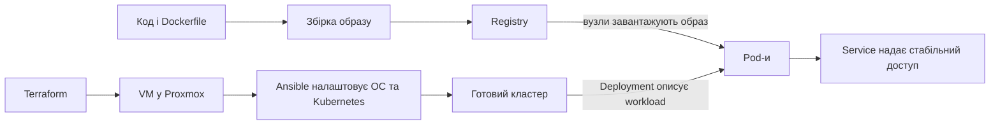
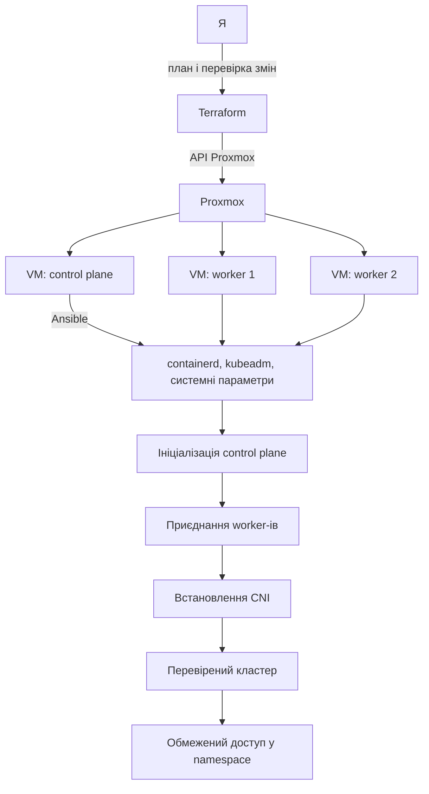
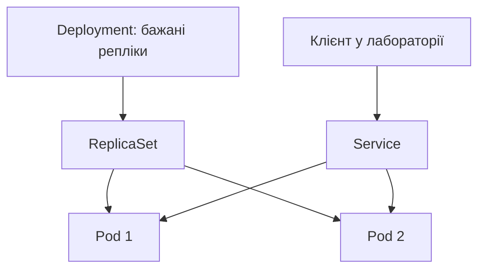

# Заняття 4. Перші кроки з Docker та Kubernetes

**Формат:** групове, 2 аудиторні години. **Самостійна робота:** 4 години.

## Мета заняття

Показати повний шлях навчального застосунку: від підготовки образу до запуску й перевірки в Kubernetes. Окремо пояснити, як я створюю кластер у Proxmox через Terraform та налаштовую його через Ansible.

## План на 2 години

| Час | Частина |
|---:|---|
| 0–10 хв | Повторення: образ, registry, контейнер |
| 10–30 хв | Побудова й тегування образу |
| 30–55 хв | Terraform: VM у Proxmox |
| 55–75 хв | Ansible: конфігурація вузлів і Kubernetes |
| 75–100 хв | Запуск Deployment та перевірка Pod-ів |
| 100–112 хв | Доступ до застосунку, межі прав |
| 112–120 хв | Питання та самостійна робота |

## 1. Наскрізний шлях



Terraform і Ansible готують інфраструктуру; вони не замінюють Dockerfile, registry або Kubernetes-маніфести. Після підготовки кластера користувач працює з Kubernetes API через `kubectl`, маючи відповідні права.

## 2. Образ: збірка, тегування, розповсюдження

Образ містить програму та залежності. Кожен Kubernetes-вузол має змогу отримати його з registry або іншого налаштованого сховища. Для відтворюваних занять використовують явний тег версії замість неоднозначного `latest`.

Навчальний приклад для статичної вебсторінки:

```dockerfile
FROM nginx:stable
COPY site/ /usr/share/nginx/html/
```

Загальна послідовність команд:

```bash
docker build -t <registry>/<namespace>/l1b-web:<version> .
docker image ls
docker push <registry>/<namespace>/l1b-web:<version>
```

`<registry>`, `<namespace>` і `<version>` замінюються значеннями, які я надаю. Не вводьте пароль чи access token безпосередньо в командний рядок, Dockerfile або Git. Якщо в курсі немає персонального registry, я можу підготувати спільний публічний навчальний образ.

## 3. Як з'являється навчальний кластер



### Роль Terraform

Terraform описує бажану інфраструктуру: VM, диски, інтерфейси та cloud-init параметри. Після `plan` я перевіряю, які ресурси будуть створені або змінені, і лише потім застосовую конфігурацію. Terraform state може містити чутливі дані або відомості про інфраструктуру; його не можна випадково публікувати у відкритому репозиторії.

### Роль Ansible

Ansible з'єднується з підготовленими вузлами та виконує налаштування: перевіряє передумови ОС, налаштовує container runtime і мережеві параметри, встановлює компоненти Kubernetes, ініціалізує control plane, додає worker-вузли й установлює CNI-плагін. Повторний запуск playbook має бути спроєктований так, щоб не створювати неконтрольованих повторних змін.

### Послідовність моєї демонстрації

1. Показати схему мережі й ролі трьох VM, не розкриваючи секрети.
2. Перевірити Terraform-план та обмежити його лише навчальними VM.
3. Після створення VM перевірити адреси, DNS і SSH-доступність.
4. Показати inventory Ansible та логічні етапи налаштування вузлів.
5. Перевірити вузли й системні Pod-и. Якщо кластер не `Ready`, не переходити до практичної частини; скористатися підготовленим робочим середовищем.
6. Пояснити різницю між доступом до Proxmox і доступом курсанта до namespace. Курсанту не потрібні права cluster-admin для цих вправ.

## 4. Запуск першого додатка

На наступних заняттях курсант створюватиме маніфести самостійно; тут я показую найкоротший шлях через Deployment:

```bash
kubectl create deployment hello --image=nginx:stable
kubectl get deployment,pods
kubectl get pods -o wide
kubectl describe deployment hello
```

Deployment просить кластер підтримувати задану кількість реплік. Він створює ReplicaSet, який створює й відновлює Pod-и. Команда `kubectl get pods -o wide` показує, на якому вузлі призначено Pod.

Щоб відкрити сервіс лише для локальної демонстрації, можна використати:

```bash
kubectl port-forward deployment/hello 8080:80
```

Поки команда працює, відкрити `http://localhost:8080` на машині, де запущено `kubectl`. Port-forward не налаштовує постійний зовнішній доступ і не є заміною Service чи Ingress.



У демо через `kubectl create deployment` стандартна кількість реплік зазвичай одна; дві Pod-коробки на схемі ілюструють, як це виглядатиме після масштабування.

## 5. Межі доступу й безпечна робота

- Terraform/Proxmox credentials залишаються у мене або в контрольованому сховищі секретів.
- Курсант отримує kubeconfig із мінімально потрібними правами та доступом до власного namespace.
- Не публікуйте kubeconfig, токени, приватні ключі або файли state у Git.
- Не створюйте `NodePort`, зовнішній LoadBalancer чи Ingress без погодження мережевого доступу.
- Після заняття очищуйте створені ресурси, не зачіпаючи системні namespace.

## Самостійна робота: вузли та панель управління

1. За виводом `kubectl get nodes -o wide` записати назви вузлів, ролі та стани.
2. За `kubectl get pods -o wide` визначити, на якому вузлі запущено навчальний Pod.
3. Описати призначення Kubernetes Dashboard і пояснити, чому він не повинен бути відкритий без автентифікації та обмеження прав.

## Контроль засвоєння

Курсант пояснює ланцюжок «Terraform → VM → Ansible → кластер → Deployment → Pod» і наводить приклад безпечного обмеження доступу курсанта.
