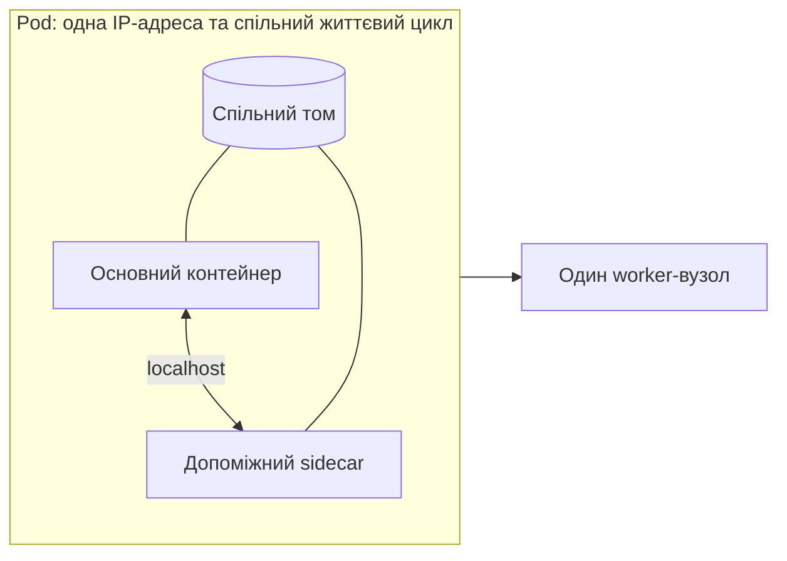
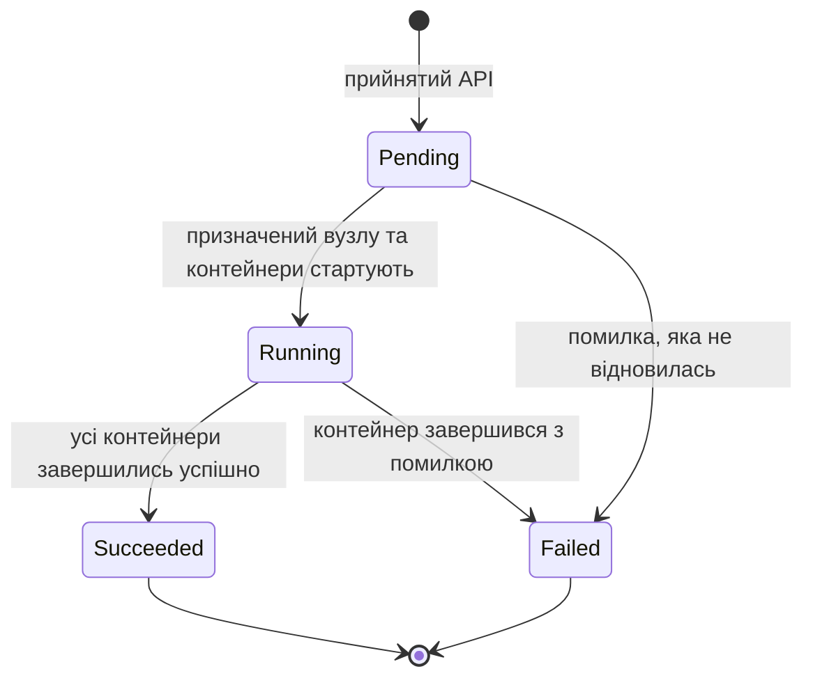
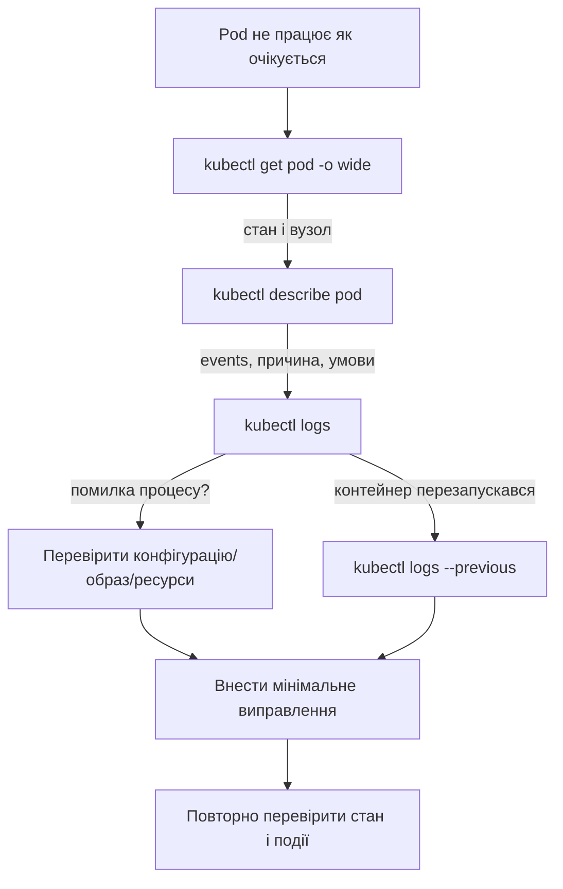

# Заняття 6. Pod-и Kubernetes

**Формат:** групове, 2 аудиторні години. **Самостійна робота:** 4 години.

## Мета заняття

Навчитися читати та пояснювати Pod-маніфест, розуміти спільне оточення контейнерів Pod-а, відрізняти стан Pod-а від стану контейнера й виконувати базову діагностику через `kubectl`.

## План на 2 години

| Час | Частина |
|---:|---|
| 0–10 хв | Повторення API-об'єктів і бажаного стану |
| 10–30 хв | Pod: контейнери, мережа, томи |
| 30–50 хв | Структура YAML-маніфесту |
| 50–70 хв | Ресурси й probes |
| 70–100 хв | Життєвий цикл та діагностика |
| 100–115 хв | Демонстрація маніфесту й помилок |
| 115–120 хв | Підсумок |

## 1. Що таке Pod

Pod — найменша одиниця розгортання в Kubernetes. Він може містити один чи кілька контейнерів, які:

- плануються на той самий вузол і мають спільний життєвий цикл;
- використовують спільний мережевий простір: у них одна IP-адреса Pod-а, а процеси можуть звертатися один до одного через `localhost`;
- можуть монтувати спільний том, якщо це описано у `spec.volumes` та `volumeMounts`.

Два контейнери в одному Pod — це не те саме, що дві репліки застосунку. Такий патерн підходить для контейнерів, яким потрібно тісно співпрацювати, наприклад основного процесу й sidecar-контейнера, що обробляє журнали.



## 2. Структура маніфесту

Маніфест — це декларативний опис ресурсу. Верхній рівень має чотири важливі частини:

| Поле | Призначення |
|---|---|
| `apiVersion` | Версія API групи, до якої належить ресурс |
| `kind` | Тип об'єкта, наприклад `Pod` |
| `metadata` | Ім'я, namespace, labels та інші metadata |
| `spec` | Бажана конфігурація ресурсу |

Приклад із ресурсами та probes:

```yaml
apiVersion: v1
kind: Pod
metadata:
  name: web-demo
  labels:
    app: web-demo
spec:
  containers:
    - name: web
      image: nginx:stable
      ports:
        - name: http
          containerPort: 80
      resources:
        requests:
          cpu: 50m
          memory: 64Mi
        limits:
          cpu: 250m
          memory: 128Mi
      readinessProbe:
        httpGet:
          path: /
          port: http
        periodSeconds: 5
      livenessProbe:
        httpGet:
          path: /
          port: http
        periodSeconds: 10
```

Відступи визначають вкладеність. `containerPort` лише описує порт контейнера; він не створює зовнішній мережевий доступ. Label `app: web-demo` — це мітка для пошуку й групування ресурсів; вона має збігатися з selector-ом контролера або Service, якщо такі створюються.

## 3. Requests, limits і probes

- **Requests** — обсяг CPU/RAM, який планувальник враховує під час розміщення Pod-а. Якщо на вузлах немає вільного ресурсу згідно з requests, Pod може залишатися `Pending`.
- **Limits** — межа використання ресурсу контейнером. Перевищення memory limit може призвести до завершення контейнера; CPU limit зазвичай обмежує швидкість використання CPU.
- **Readiness probe** — визначає, чи готовий контейнер приймати трафік. Неготовий Pod не включається до звичайного обслуговування Service.
- **Liveness probe** — визначає, чи треба перезапустити контейнер, який Kubernetes вважає завислим або несправним.
- **Startup probe** — дає повільно стартуючій програмі час запуститися, перш ніж почнуть діяти liveness/readiness перевірки.

Невдала liveness probe може створити нескінченні перезапуски. Перевірка має відповідати реальному стану програми й мати коректні затримки, а не просто існувати в YAML.

## 4. Життєвий цикл і стани



Фаза Pod-а — лише загальний підсумок. Стани контейнерів і причини перезапуску дають детальнішу інформацію. Наприклад, `CrashLoopBackOff` зазвичай є причиною очікування/повторного запуску контейнера, а не окремою фазою Pod-а. Pod із фазою `Running` теж не обов'язково готовий приймати запити — для цього є readiness probe.

## 5. Діагностика: від симптому до доказу



Корисні команди:

```bash
kubectl apply -f pod.yaml
kubectl get pod web-demo -o wide
kubectl describe pod web-demo
kubectl logs web-demo
kubectl logs web-demo --previous
kubectl delete -f pod.yaml
```

При кількох контейнерах у Pod потрібно вказати `kubectl logs <pod> -c <container>`. `--previous` показує журнали попереднього екземпляра контейнера, якщо він перезапускався.

| Симптом | Що перевірити спочатку |
|---|---|
| `Pending` | Події `describe`: доступність ресурсів, відповідність вузлів, квоти |
| `ImagePullBackOff` | Назву/тег образу, доступність registry, права завантаження образу |
| `CrashLoopBackOff` | `logs --previous`, команду запуску, конфігурацію та probes |
| `Running`, але не Ready | Readiness probe та її події |

## Моя демонстрація

1. Застосувати маніфест `web-demo` і показати його розміщення.
2. Пояснити кожне поле YAML, зіставляючи його з таблицею.
3. Показати журнали та `describe`, знайти pod events.
4. Змінити тег образу на неіснуючий, спостерігати за помилкою завантаження й відновити правильний тег.
5. Пояснити, чому прямий Pod не відновлюється після видалення; на наступному занятті це буде порівняно з Deployment.

Змодельовану помилку виконувати лише у виданому навчальному namespace.

## Самостійна робота: управління Pod-ами

Підготувати маніфест одного Pod-а для узгодженого вебобразу, додати label і resource requests. У нотатках вказати команди для перевірки label, журналів і причини помилки запуску. Пояснити, чому прямий Pod не є надійною заміною Deployment.

## Контроль засвоєння

Курсант знаходить у маніфесті ім'я, образ і label; відрізняє Pod phase від container state та обґрунтовує наступну діагностичну команду за симптомом.
