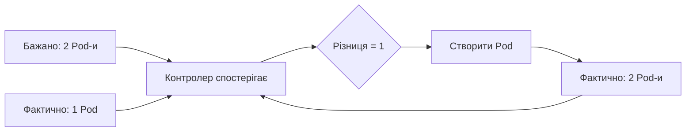
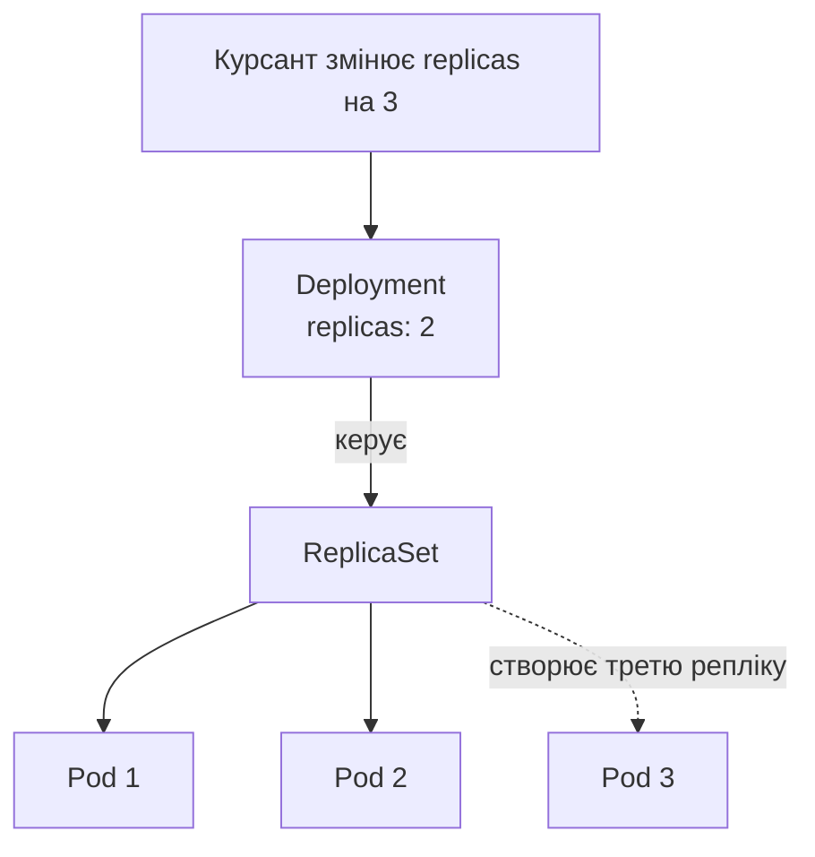
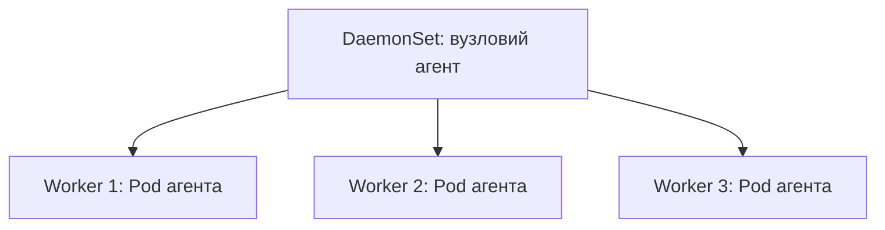
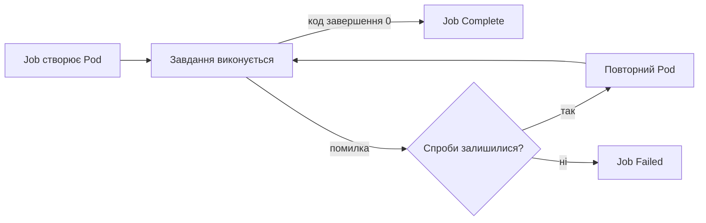
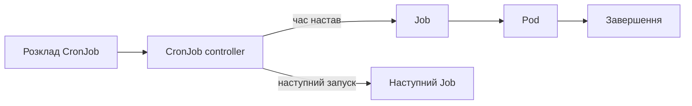

# Заняття 8. Контролери Kubernetes

**Формат:** групове, 2 аудиторні години. **Самостійна робота:** 2 години.

## Мета заняття

Навчитися обирати контролер відповідно до життєвого циклу задачі: постійний сервіс, вузловий агент, одноразове чи періодичне виконання. Пояснити, як контролери підтримують бажаний стан.

## План на 2 години

| Час | Частина |
|---:|---|
| 0–10 хв | Повторення Pod і reconciliation loop |
| 10–35 хв | Deployment та ReplicaSet |
| 35–50 хв | DaemonSet |
| 50–75 хв | Job |
| 75–95 хв | CronJob та політики виконання |
| 95–110 хв | Вибір контролера за сценарієм |
| 110–120 хв | Запитання й самостійна робота |

## 1. Чому Pod-и створюють через контролери

Pod — короткоживучий об'єкт. Його можуть видалити, він може завершитись, або вузол може стати недоступним. Для довготривалого застосунку важливо зберігати не конкретний Pod, а бажаний стан, наприклад «потрібні дві репліки».

Контролер спостерігає за ресурсами. Якщо кількість керованих Pod-ів не відповідає бажаній, він створює або видаляє Pod-и:



Це самовідновлення об'єктів, а не гарантія, що бізнес-логіка застосунку правильна. Якщо програма має помилку, контролер може перезапускати її знову й знову.

## 2. Deployment і ReplicaSet

**Deployment** керує декларативними оновленнями stateless-застосунку й підтримує задану кількість реплік. Deployment створює **ReplicaSet**, а той забезпечує потрібну кількість Pod-ів.



Приклад:

```yaml
apiVersion: apps/v1
kind: Deployment
metadata:
  name: web
  labels:
    app: web
spec:
  replicas: 2
  selector:
    matchLabels:
      app: web
  template:
    metadata:
      labels:
        app: web
    spec:
      containers:
        - name: nginx
          image: nginx:stable
          ports:
            - containerPort: 80
```

`spec.selector.matchLabels` має відповідати labels у `spec.template.metadata.labels`. Саме за ними ReplicaSet знаходить Pod-и, якими має керувати. Невідповідні selectors можуть призвести до помилок створення або керування.

Приклади команд:

```bash
kubectl get deployment,replicaset,pods
kubectl scale deployment web --replicas=3
kubectl rollout status deployment/web
kubectl rollout history deployment/web
```

Коли курсант вручну видаляє Pod, керований Deployment, ReplicaSet створює заміну. Під час оновлення образу Deployment може створити новий ReplicaSet і поступово перейти на нову версію. Це не автоматичний rollback програми й не перевірка правильності її логіки.

## 3. DaemonSet

**DaemonSet** забезпечує Pod на кожному вузлі, який відповідає умовам розміщення. Якщо до кластера додають новий відповідний вузол, DaemonSet зазвичай створює там Pod; якщо вузол видаляють — видаляється й відповідний Pod.



Типові приклади — агенти моніторингу або збору логів на кожному вузлі. Звичайний вебзастосунок зазвичай розгортають через Deployment: його кількість реплік визначають потребою сервісу, а не кількістю вузлів.

## 4. Job

**Job** керує обмеженим завданням, яке має завершитись. Наприклад, одноразово обробити пакет даних або виконати безпечну навчальну команду. У `spec` можна визначити число успішних завершень (`completions`), паралельність (`parallelism`) і кількість повторних спроб (`backoffLimit`).



Повторна спроба може виконати дію більше одного разу. Тому завдання, яке змінює зовнішні дані, має бути ідемпотентним або мати інший захист від повторної обробки. Не слід припускати гарантію «виконано рівно один раз».

## 5. CronJob

**CronJob** створює Job за календарним розкладом. Його поля визначають час запуску, шаблон Job і політику паралельних виконань.



Приклад структури:

```yaml
apiVersion: batch/v1
kind: CronJob
metadata:
  name: report-demo
spec:
  schedule: "0 9 * * 1-5"
  concurrencyPolicy: Forbid
  successfulJobsHistoryLimit: 1
  failedJobsHistoryLimit: 1
  jobTemplate:
    spec:
      backoffLimit: 1
      activeDeadlineSeconds: 60
      template:
        spec:
          restartPolicy: Never
          containers:
            - name: report
              image: busybox:stable
              command: ["sh", "-c", "echo report task completed"]
```

У цьому прикладі розклад означає 09:00 з понеділка по п'ятницю у часовому поясі контролера, якщо явно не заданий інший підтримуваний часовий пояс. Поля history limit обмежують кількість збережених завершених Job-ів; `activeDeadlineSeconds` обмежує тривалість виконання. `Forbid` пропускає новий запуск, якщо попередній Job ще активний.

Розклад CronJob не є realtime-гарантією: запуски залежать від роботи контролера і стану кластера. Для навчання використовуйте рідкий і безпечний розклад, обмежуйте час і кількість повторів та не створюйте завдання з неконтрольованими зовнішніми ефектами.

## 6. Як обрати контролер

| Задача | Ресурс | Чому |
|---|---|---|
| Постійний API або вебсервіс із потрібними репліками | Deployment | Підтримує репліки та керовані оновлення |
| Агент на кожному робочому вузлі | DaemonSet | Прив'язує екземпляр до кожного відповідного вузла |
| Одноразова пакетна обробка | Job | Відстежує успішне завершення й обмежені повтори |
| Періодична генерація звіту | CronJob | Створює Job за розкладом |

## Демонстрація викладача

1. Створити Deployment із двома репліками й показати зв'язок Deployment → ReplicaSet → Pod.
2. Видалити один керований Pod і дочекатися заміни.
3. Змінити число реплік та перевірити результат.
4. Порівняти з одиночним Pod-ом, створеним напряму.
5. Пояснити DaemonSet і продемонструвати Job/CronJob у навчальному namespace без частого або безстрокового запуску.

## Самостійна робота: CronJob

Підготувати CronJob для безпечного завдання, яке завершується швидко й не змінює зовнішні системи. Вказати `schedule`, образ, команду, `restartPolicy`, `concurrencyPolicy`, `backoffLimit`, `activeDeadlineSeconds` і межі історії. Пояснити, як уникнути неконтрольованого накопичення невдалих Job-ів.

## Контроль засвоєння

Для сценаріїв «постійний вебсервіс», «вузловий агент», «одноразова обробка», «періодичне завдання» курсант обирає контролер і пояснює вибір та ризик повторного запуску.
