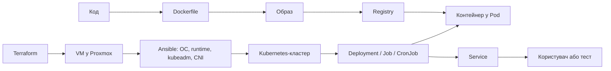
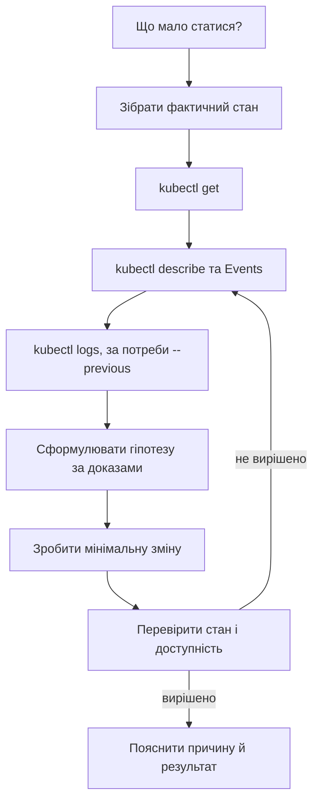

# Заняття 10. Повторення та диференційований залік

**Формат:** групове, 2 аудиторні години.

## Мета заняття

Систематизувати шлях від контейнерного образу до Kubernetes workload-а, зв'язати поняття Docker, кластера, Pod-ів і контролерів та перевірити навички доказової діагностики. Формат і правила диференційованого заліку затверджуються закладом.

## План на 2 години

| Час | Частина |
|---:|---|
| 0–15 хв | Коротке повторення Docker та образів |
| 15–35 хв | Архітектура кластера та підготовка на Proxmox |
| 35–55 хв | Pod, YAML, Service й діагностика |
| 55–75 хв | Контролери й сценарії їх використання |
| 75–105 хв | Усні/практичні контрольні сценарії |
| 105–115 хв | Підсумок, самооцінка, типові помилки |
| 115–120 хв | Завершення за локальною процедурою |

## 1. Наскрізна схема курсу

Послідовність важлива:

1. Підготувати відтворюваний образ і зробити його доступним вузлам.
2. Підготувати кластер і перевірити його готовність.
3. Описати workload та спосіб керування його життєвим циклом.
4. Перевірити фактичний стан, журнали й доступність.
5. Очистити ресурси, не видаляючи дані чи ресурси інших користувачів.

## 2. Підсумкова таблиця понять

| Поняття | Коротко | Типова помилка |
|---|---|---|
| Image | Шаблон для запуску контейнера | Вважати, що образ сам є процесом |
| Container | Запущений процес ізоляції на конкретному runtime | Очікувати, що writable layer є постійним сховищем |
| Pod | Одиниця планування Kubernetes із одним чи кількома контейнерами | Вважати Pod повною VM або довготривалою гарантією |
| Deployment | Контролює репліки та оновлення застосунку | Створювати окремі Pod-и вручну для production-подібного сервісу |
| Service | Стабільний спосіб знаходити набір Pod-ів у мережі | Вважати `containerPort` еквівалентом зовнішнього доступу |
| Job | Контролює завершення обмеженої задачі | Вважати, що повтори ніколи не дублюють побічну дію |
| CronJob | Створює Job за розкладом | Вважати, що планувальник гарантує запуск рівно в секунду розкладу |
| Terraform | Описує й керує інфраструктурними ресурсами | Зберігати state або credentials у відкритому Git |
| Ansible | Налаштовує ОС та програмне забезпечення вузлів | Передавати курсантам root/Proxmox доступ замість namespace-доступу |

## 3. Алгоритм діагностики

Під час відповіді важливо розділяти:

- **спостереження:** що саме показали команда, подія або журнал;
- **гіпотезу:** що може бути причиною;
- **перевірку:** яка наступна дія підтвердить або спростує припущення;
- **виправлення:** найменша зміна, яка усуває підтверджену причину.

Не варто починати з видалення всіх ресурсів чи випадкової зміни конфігурації: це може знищити корисні докази або вплинути на інших курсантів.

## 4. Контрольні сценарії з поясненнями

### Сценарій A: Pod у `ImagePullBackOff`

**Запитання:** які перші перевірки?

**Очікуваний напрям відповіді:** `kubectl describe pod` і Events, перевірка повної назви та тегу образу, доступності registry з вузлів і прав завантаження приватного образу. Не надсилати пароль у маніфесті чи звіті. Виправити тег/налаштування доступу й переконатися, що нова спроба завантаження успішна.

### Сценарій B: Deployment має менше готових реплік

**Запитання:** як відрізнити проблему контролера від проблеми конкретного Pod-а?

**Очікуваний напрям відповіді:** порівняти `kubectl get deployment,replicaset,pods`, перевірити `describe deployment` і події Pod-а. Переконатися, що `spec.selector` збігається з labels Pod template. Якщо Pod не планується — перевірити події, requests, квоти й доступність вузлів.

### Сценарій C: Pod `Running`, але вебсторінка недоступна

**Запитання:** чи достатньо перевірити Pod?

**Очікуваний напрям відповіді:** ні. Перевірити readiness, Service, selector і endpoints, порт процесу, а також конкретний спосіб доступу. `containerPort` сам по собі не публікує порт. Зовнішній доступ не налаштовувати без дозволу.

### Сценарій D: CronJob створює зайві виконання

**Запитання:** які обмеження допоможуть?

**Очікуваний напрям відповіді:** перевірити розклад і тривалість попереднього Job-а; налаштувати відповідну `concurrencyPolicy`, `activeDeadlineSeconds`, `backoffLimit` та межі історії; переконатися, що завдання безпечне при повторі.

## 5. Запитання для усної перевірки

- Чим образ відрізняється від контейнера, а контейнер — від Pod-а?
- Що робить Terraform у навчальній інфраструктурі, а що — Ansible?
- Які ключові функції control plane та worker-вузла?
- Як контролер реагує на видалення Pod-а з Deployment?
- Коли застосовують Deployment, DaemonSet, Job і CronJob?
- Що означають requests та limits?
- Як відрізнити Pod phase від причини стану контейнера?
- Як Service знаходить потрібні Pod-и?
- Які дані не можна додавати до Git?
- Як діяти, якщо в namespace немає достатніх прав?

## 6. Критерії поточної групової роботи

Якщо групове заняття №10 оцінюється за загальним правилом курсу, можна використати шкалу до 4 балів:

| Критерій | Бали |
|---|---:|
| Точні базові поняття й архітектура | 1 |
| Коректне читання маніфесту/стану ресурсу | 1 |
| Діагностика спирається на конкретні докази | 1 |
| Безпечний спосіб виправлення та пояснення | 1 |
| **Разом** | **4** |

Окремі бали за диференційований залік у цій схемі не додаються. Підсумкова шкала курсу та допуск описані в [загальному плані](../README.md#оцінювання). Кількість питань, формат, тривалість і правила повторного складання встановлюються локальними вимогами закладу.
